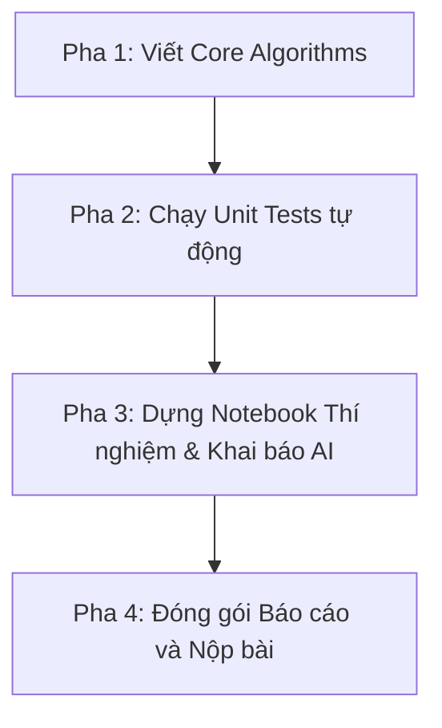

# Hướng dẫn quy trình thực hiện & Thử nghiệm (Workflows)

## 1. Tổng quan quy trình làm bài

Theo cấu trúc bài tập lớn hợp nhất Thị giác máy tính (UTH), quy trình hoàn thiện bao gồm 3 pha:



---

## 2. Các bước triển khai chi tiết

### Bước 1: Kiểm thử mã nguồn lõi trong `src/`
Đảm bảo tất cả các ca kiểm thử tự động đều đã vượt qua (`OK`):
```bash
python -m unittest discover tests
```

### Bước 2: Tạo môi trường Notebook và chạy thí nghiệm
Tạo thư mục `notebooks/` và tạo các file `.ipynb` tương ứng với 3 kỹ thuật:
- `notebooks/01_clahe_experiments.ipynb`
- `notebooks/02_integral_threshold_experiments.ipynb`
- `notebooks/03_multiscale_hough_experiments.ipynb`

### Bước 3: Tuân thủ quy định chép Prompt AI
Khi dùng AI để sinh code vẽ biểu đồ hoặc tạo ảnh mẫu:
1. Sao chép prompt từ `.agent/prompt_templates.md` gửi cho AI.
2. Sao chép lại toàn bộ phản hồi và dán ô Markdown `### Có dùng AI hỗ trợ` vào trước ô code trong Notebook.
3. Chạy toàn bộ Notebook từ đầu đến cuối (`Restart and Run All Cells`) để đảm bảo không có ô nào phát sinh lỗi.
